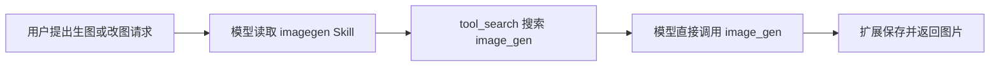

# Pi 生图扩展首版规格

以 [Codex `5e857c65a`](https://github.com/openai/codex/commit/5e857c65a529587c052b656769122b7902e8ed3d) 的默认 `image_gen` 工作流为参考。用户用自然语言生成或编辑图片，能看到结果、取得本地文件，并用该文件继续编辑。扩展直连 ChatGPT 的 Codex 生图接口，使用 Pi 的 `openai-codex` 登录。以下行为以本地源码为依据，订阅直连还需要运行验证。

## 发现工具

- 扩展以 `exposure: "deferred"` 注册 `image_gen`。平时模型看到 Skill 的名称、简短说明和路径，生图工具的完整声明在搜索前不进入请求。启用 Pi 的 `tool_search` 是安装条件。安装说明写明 `defaultTools` 的 `+tool_search` 配置。
- Skill 指示模型在工具尚未加载时搜索精确名称 `image_gen`。找到后模型在下一次请求拿到工具声明，后续同一会话分支可以直接调用。模型漏读 Skill 时，用户可用 `/skill:imagegen` 显式加载。
- Skill 沿用 Codex 的提示词和交付原则。简单请求可以补充相关的构图或光线建议，详细请求保留原有约束，文字内容按用户指定的字面值保留。改图时说明修改对象和需要保留的内容。预览展示图片，项目素材交付到工作区，用户指定路径时按要求交付。处理透明图时保留 alpha 通道。
- Codex 把 `imagegen_description.md` 作为工具说明。Pi 的工具说明也使用这份原文作底稿，适配工具名、图片读取和历史取图差异。Pi 的 `promptSnippet` 和 `promptGuidelines` 留空，模型只在工具加载后收到这段完整说明。集成测试记录 Pi 实际发给模型的声明。

## 工具输入与请求

| 参数 | 首版行为 |
| --- | --- |
| `prompt` | 必填字符串，按原文发送给生图接口 |
| `transparent_background` | 可选布尔值，默认 `false`。需要保持参考图的透明背景时，由 Skill 指导模型传 `true` |
| `referenced_image_paths` | 可选绝对路径数组，最多 5 个，按传入顺序处理。省略或空数组表示生成新图 |

未知字段、相对路径、超出数量的参考图，以及无法读取或识别的图片应在发请求前报错。首版参考图支持 PNG、JPEG 和 WebP，按内容识别格式，把原始字节编码成对应 MIME 类型的 data URL。Codex 也原样传这三种格式，但会把部分其他可解码格式转成 PNG。首版遇到这些格式时提示先转成支持的格式。

| 调用 | 请求 |
| --- | --- |
| 生成新图 | `POST https://chatgpt.com/backend-api/codex/images/generations` |
| 按文件改图 | `POST https://chatgpt.com/backend-api/codex/images/edits`，增加 `images: [{ "image_url": "data:..." }]` |

两种请求使用 JSON。共同字段为 `model: "gpt-image-2"`、`prompt`、`quality: "auto"`、`size: "auto"`。`background` 总是发送，布尔值为 `true` 时用 `"transparent"`，否则用 `"opaque"`。省略 `n`、`response_format` 和 `output_format`。

- 每次执行从 `ctx.modelRegistry.getProviderAuth("openai-codex")` 解析认证。Pi 负责按需刷新，并把 access token 放在 `auth.apiKey`。按 Pi 内置 Codex provider 的方式从 token 取得 ChatGPT 账户 ID，发送 `Authorization` 和 `ChatGPT-Account-ID`。缺少登录时提示在 Pi 通过 `/login` 登录。
- Codex 还会发送自己的 `x-codex-image-turn-id`，以及可用时的 `originator` 和 `x-codex-turn-metadata`。Pi 使用自身生成的 UUID 关联调用，发送到 `x-codex-image-turn-id`。Codex 会话元数据和客户端标识依赖宿主，首版不构造这两项。源码证实 Codex 客户端的发送行为，尚未验证 Pi 的请求会被实际订阅端点接受。
- 请求接入 Pi 的取消信号。遇到 `429` 提示配额或限流。可识别的图片配额优先采用响应体 `error.resets_at`，其次采用对应已用尽的配额窗口时间。无恢复时间时只报告限流。保存 `x-codex-imagegen-request-id` 供排查，凭据不进入错误文本或工具结果。

## 结果和连续改图

- 取 `data[0].b64_json`，解码后保存原始 PNG。空结果、无效图片或保存失败要有明确反馈。默认路径为 `<Pi agent 目录>/generated_images/<会话 ID>/<调用 ID>.png`，避免把预览文件直接写进项目。
- 工具同时返回图片内容块和绝对路径。支持图片的 Pi 终端使用内置工具结果预览，其余终端可以打开文件。模型也能拿到路径，用于复制成项目素材或继续编辑。项目交付避免覆盖现有文件，用户明确要求替换时除外。
- “把刚才那张改一下”优先使用当前会话中已经返回、能明确对应到目标图片的路径。首版暂缓 `num_last_images_to_include`。只有对话内粘贴图等无可用文件路径的情形才需要该机制。Skill 对此明确说明，要求用户把图片保存为文件并提供路径，避免拿错图。
- GIF 是该 Codex 提交新增的开发中功能，默认关闭。首版以默认静态图行为为准。

## 验收

| 场景 | 可观察结果 |
| --- | --- |
| 普通对话 | 模型的请求中没有 `image_gen` 的完整声明 |
| 第一次说“生成一张图” | 模型读取 Skill，搜索并调用 `image_gen`。测试上游收到 `/images/generations` 和与 Codex 一致的静态图 JSON 字段 |
| 要求透明背景 | 请求发送 `"background": "transparent"`。使用含 alpha 的 PNG 响应测出保存的字节和 alpha 未改变 |
| 指定一张或多张本地参考图 | 请求改走 `/images/edits`，图片顺序、MIME 和字节符合输入文件 |
| 编辑刚生成的图 | 第二次调用把前一次返回的文件路径用作参考图，第二份产物单独保存 |
| 只有粘贴图或无法判断目标 | 模型说明需要文件路径，不发改图请求 |
| 登录缺失、请求取消、配额不足或返回无图片 | 提示能解释当前状态，没有把失败误报成成功，也没有泄露认证信息 |
| 预览及项目交付 | 工具返回可打开的文件路径。项目素材按需从默认产物位置复制到工作区 |

先用本地模拟响应验证请求、出图文件和错误处理，再在 Pi 中走一遍 Skill 的发现流程。最终用一次真实的订阅出图确认直连。真实编辑是否通过需要有独立结果，模拟成功不能代替这项证据。

## 核对依据

- Codex [工具实现](https://github.com/openai/codex/blob/5e857c65a/codex-rs/ext/image-generation/src/tool.rs)、[工具说明](https://github.com/openai/codex/blob/5e857c65a/codex-rs/ext/image-generation/imagegen_description.md)、[Skill](https://github.com/openai/codex/blob/5e857c65a/codex-rs/skills/src/assets/samples/imagegen/SKILL.md) 和[产物路径](https://github.com/openai/codex/blob/5e857c65a/codex-rs/ext/image-generation/src/artifact.rs)。
- Codex [请求构造与附加头](https://github.com/openai/codex/blob/5e857c65a/codex-rs/ext/image-generation/src/backend.rs)、[接口与响应](https://github.com/openai/codex/blob/5e857c65a/codex-rs/codex-api/src/endpoint/images.rs)、[默认服务地址](https://github.com/openai/codex/blob/5e857c65a/codex-rs/model-provider-info/src/lib.rs)、[订阅认证头](https://github.com/openai/codex/blob/5e857c65a/codex-rs/model-provider/src/bearer_auth_provider.rs) 和[集成测试](https://github.com/openai/codex/blob/5e857c65a/codex-rs/app-server/tests/suite/v2/imagegen_extension.rs)。
- Codex [参考图格式处理](https://github.com/openai/codex/blob/5e857c65a/codex-rs/utils/image/src/lib.rs)和[功能默认值](https://github.com/openai/codex/blob/5e857c65a/codex-rs/features/src/lib.rs)。
- 本机 Pi 1.6.0 发行包的 `pi-coding-agent/docs/skills.md`、`docs/extensions.md` 和 `docs/cli.md`，以及 `dist/core/model-registry.js`、`dist/modes/interactive/components/tool-execution.js`。认证行为对应 `pi-ai/dist/auth/resolve.js`、`dist/auth/oauth/openai-codex.js` 和 `dist/api/openai-codex-responses.js`。
